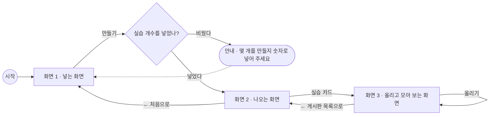

# PRD — 실습 게시판 만들기

- 상태 : 완성
- 한 줄 정의 : [실습이 스무 개쯤 되는 과정을 혼자 진행하는 강사가, 실습 번호만 넣으면 실습마다 결과물 게시판이 한 번에 생겨서, 노션 페이지를 실습마다 복사하지 않고 결과물을 한곳에서 모아 본다]

## 1. 문제

### 배경

- 실습이 스무 개쯤 되는 과정을 강사 한 사람이 혼자 진행한다.
- 지금은 노션 갤러리 페이지를 실습마다 복사해 만들고, 채팅에 링크를 붙여 준다.
- 실습마다 결과물 받을 페이지를 따로 만들어야 하고, 누가 안 올렸는지 이름을 하나씩 대조해야 한다.
- 이 일은 실습 슬라이드를 넘길 때마다, 그리고 수업이 끝나고 결과물을 확인할 때 생긴다.

### 목표

- 실습 번호를 한 번 넣으면 실습마다 결과물 게시판이 한 번에 생기게 해서, 노션 페이지를 실습마다 복사하지 않게 한다.
- 실습에 올라온 결과물을 갤러리처럼 한 화면에 모아 본다.
- 성공을 무엇으로 확인할지 (예: 준비 시간, 게시판 개수 같은 숫자 기준) : (질문 필요)

## 2. 사용자

### 페르소나

- 누구인가 : 실습이 스무 개쯤 되는 과정을 혼자 진행하는 온라인 강사 (나)
- 언제 쓰는가 : 실습 슬라이드를 넘길 때마다, 그리고 수업이 끝나고 결과물을 확인할 때
- 왜 쓰는가 : 실습마다 결과물 받을 페이지를 따로 만들고, 누가 안 올렸는지 이름을 하나씩 대조해야 해서
- 지금은 어떻게 하는가 : 노션 갤러리 페이지를 실습마다 복사해 만들고, 채팅에 링크를 붙여 준다
- 다른 사람이 쓴다면 : 수강생이 쓴다면 게시판을 만드는 화면은 필요 없고, 내 결과물을 올리는 칸이 먼저 보여야 한다

### 사용자 스토리

- 실습이 스무 개쯤 되는 과정을 혼자 진행하는 강사로서, 실습 번호를 넣어 실습마다 결과물 게시판을 한 번에 만들고 싶다. 노션 페이지를 실습마다 복사하지 않으려고.
- 실습이 스무 개쯤 되는 과정을 혼자 진행하는 강사로서, 수강생이 게시판에 이름 · 사진 · 한 줄 설명을 올릴 수 있게 하고 싶다. 결과물을 한곳에서 모아 보려고.
- 실습이 스무 개쯤 되는 과정을 혼자 진행하는 강사로서, 올라온 결과물을 갤러리처럼 모아 보고 싶다. 결과물을 한곳에서 모아 보려고.

## 3. 범위

### 넣을 기능

1. 실습 번호를 넣으면 실습마다 결과물 게시판이 한 번에 생긴다 (핵심)
2. 게시판에 이름 · 사진 · 한 줄 설명을 올린다
3. 올라온 결과물을 갤러리처럼 모아 본다

### 기능 요구사항

- 화면 1의 「실습 번호 (예: 3)」 칸에 숫자를 넣고 [만들기]를 누르면, 넣은 번호만큼 결과물 게시판이 한 번에 만들어지고 화면 2로 넘어간다.
- 화면 1에서 실습 번호를 비워 두고 [만들기]를 누르면, 입력 칸 바로 아래에 "실습 번호를 넣어 주세요. 예: 3"이 눈에 띄게 보이고 게시판은 하나도 만들지 않는다.
- 화면 2에서는 「실습 1」「실습 2」「실습 3」처럼 제목이 붙은 빈 결과물 게시판이 카드 모양으로 한 줄에 나란히 보인다.
- 화면 2에서 실습 카드를 누르면 그 실습의 화면 3(「실습 1」 결과물 게시판)으로 이동한다.
- 화면 2에서 [← 처음으로]를 누르면 화면 1로 돌아간다.
- 화면 3에서 이름 · 사진(파일 선택) · 한 줄 설명을 넣고 [올리기]를 누르면, 아래 갤러리에 사진 · 이름 · 한 줄 설명이 담긴 결과물 카드가 한 장 쌓인다.
- 화면 3에서 사진을 고르지 않고 [올리기]를 누르면, 칸 아래에 "사진을 1장 올려 주세요" 안내가 보이고 갤러리에는 결과물 카드가 늘지 않는다.
- 결과물을 올릴 때 사진 1장은 필수이고, 이름과 한 줄 설명은 비워 두어도 올라간다. 사진은 한 번에 1장.
- 화면 1의 실습 번호 칸에 20보다 큰 숫자를 넣고 [만들기]를 누르면, 입력 칸 바로 아래에 "1부터 20까지 넣어 주세요" 안내가 보이고 게시판은 하나도 만들지 않는다.
- 화면 3에서 [← 게시판 목록으로]를 누르면 화면 2로 돌아간다.
- 만들어진 게시판과 올라온 결과물은 화면을 새로 고쳐도 그대로 남아 있다.
- 만들어진 게시판 링크를 수강생에게 어떻게 전달하는지 : (질문 필요)

### 비목표

- 학생이 각자 휴대폰에서 동시에 올린다 — 여러 사람이 동시에 쓰는 것은 이 과정에서 다루지 않는다
- 강사가 슬라이드를 넘기면 학생 화면도 같이 넘어간다 — 여러 화면을 실시간으로 맞춰야 한다
- 로그인해서 내 수업만 모아 본다 — 로그인은 이 과정에서 다루지 않는다
- 수강생 명단을 넣으면 안 올린 사람 이름을 보여준다 — 없어도 결과물을 모아 보는 데는 지장이 없다
- 퀴즈 번호를 누르면 응답 수가 막대로 보인다 — 게시판과는 다른 서비스다
- 결과물에 댓글을 단다 — 없어도 결과물을 모아 보는 데는 지장이 없다
- 결과물을 파일 하나로 내려받는다 — 없어도 결과물을 모아 보는 데는 지장이 없다

## 4. 화면

### 사용자 흐름

- 화면 1 · 넣는 화면 : 「실습 결과물 게시판 만들기」 제목 아래 실습 번호 칸과 [만들기] 버튼이 있고, 비워 두고 누르면 칸 아래에 안내 문구가 뜬다.
- 화면 2 · 나오는 화면 : 「만들어진 결과물 게시판」 제목 아래 「실습 1」「실습 2」「실습 3」 빈 게시판 카드가 한 줄에 나란히 보이고, 위쪽에 [← 처음으로]가 있다.
- 화면 3 · 올리고 모아 보는 화면 : 「실습 1」 결과물 게시판에서 이름 · 사진 · 한 줄 설명을 넣고 [올리기]를 누르면 아래에 결과물이 갤러리처럼 모여 보이고, 위쪽에 [← 게시판 목록으로]가 있다.

## 5. 완성 기준

### 수용 기준

- 실습 번호에 3을 넣고 [만들기]를 누르면, 「실습 1」「실습 2」「실습 3」 제목이 붙은 빈 결과물 게시판 세 개가 카드 모양으로 한 줄에 나란히 보인다.
- 실습 번호 칸을 비워 두고 [만들기]를 누르면, 입력 칸 바로 아래에 "실습 번호를 넣어 주세요. 예: 3" 안내가 보이고 게시판 카드는 한 장도 보이지 않는다.
- 실습 번호 칸에 21을 넣고 [만들기]를 누르면, 입력 칸 바로 아래에 "1부터 20까지 넣어 주세요" 안내가 보이고 게시판 카드는 한 장도 보이지 않는다.
- 화면 2에서 「실습 1」 카드를 누르면, 「실습 1」 결과물 게시판(화면 3)이 보인다.
- 화면 3에서 이름 · 사진 · 한 줄 설명을 넣고 [올리기]를 누르면, 아래 갤러리에 그 사진 · 이름 · 한 줄 설명이 담긴 결과물 카드가 한 장 늘어나 보인다.
- 화면 3에서 사진만 고르고 [올리기]를 누르면, 아래 갤러리에 결과물 카드가 한 장 늘어나 보인다.
- 화면 3에서 사진 없이 [올리기]를 누르면, 칸 아래에 "사진을 1장 올려 주세요" 안내가 보이고 갤러리의 결과물 카드 수는 그대로다.
- 화면 3에서 [올리기]를 세 번 해서 결과물을 셋 올리면, 아래 갤러리에 결과물 카드 세 장이 한 화면에 모여 보인다.
- 화면 3에서 [← 게시판 목록으로]를 누르면 화면 2가, 화면 2에서 [← 처음으로]를 누르면 화면 1이 다시 보인다.
- 화면 3에서 결과물을 올린 뒤 화면을 새로 고치면, 화면 2의 실습 카드와 화면 3 갤러리의 결과물 카드가 그대로 보인다.
